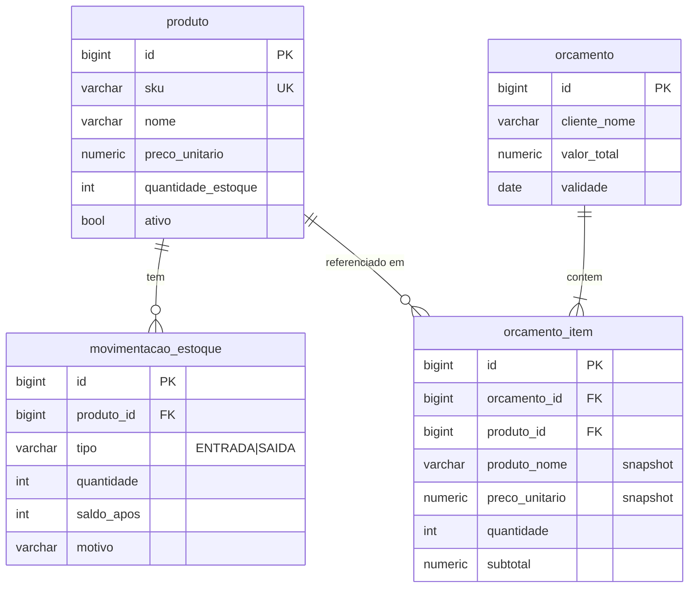

# Gestão Loja — MVP

Sistema de gestão para loja com **cadastro de produtos**, **controle de estoque** (entradas/saídas com histórico) e **orçamentos com geração de PDF**.

| Camada    | Tecnologia                                                        |
|-----------|-------------------------------------------------------------------|
| Frontend  | React 18 + TypeScript + Vite + React Router                       |
| Backend   | Java 21 + Spring Boot 3.3 (Web, Data JPA, Validation) + OpenPDF   |
| Banco     | Supabase (PostgreSQL) — migrations versionadas com Flyway         |

---

## Arquitetura

```mermaid
flowchart LR
    U[Navegador] -->|SPA| FE[React + Vite]
    FE -->|REST JSON /api/*| BE[Spring Boot API]
    BE -->|JDBC + Flyway| DB[(Supabase Postgres<br/>schema "loja")]
    BE -->|application/pdf| FE
```

**Decisões principais**

1. **Supabase como Postgres gerenciado, acessado só pelo backend.** O React nunca fala direto com o Supabase; toda regra de negócio fica no Java. As tabelas ficam no schema **`loja`** (não no `public`), então **não são expostas pela Data API/PostgREST** do Supabase — não há risco de alguém ler/escrever com a `anon key`.
2. **Flyway é dono do schema** (`hibernate.ddl-auto=validate`). Ao subir, o backend cria/atualiza as tabelas no Supabase automaticamente. Mudanças futuras = novo arquivo `V2__...sql`.
3. **Estoque com trava pessimista.** Cada movimentação faz `SELECT ... FOR UPDATE` no produto, valida saldo (nunca negativo — também garantido por `CHECK` no banco) e grava o registro em `movimentacao_estoque` com o saldo resultante. Assim duas operações simultâneas não se sobrescrevem e todo saldo é auditável.
4. **Orçamento é calculado no servidor.** O front envia apenas `produtoId` + `quantidade`; preço e total vêm do cadastro. Os itens guardam **snapshot** (nome e preço da época), então editar um produto depois não altera orçamentos antigos.
5. **Orçamento não baixa estoque** (é proposta, não venda). O front só avisa quando a quantidade passa do saldo.
6. **PDF gerado no backend** (OpenPDF): layout idêntico em qualquer navegador e pronto para ser enviado por e-mail/WhatsApp no futuro.
7. **Exclusão lógica de produtos** (`ativo=false`) para preservar histórico de estoque e orçamentos.
8. **Organização por feature** no backend (`produto/`, `estoque/`, `orcamento/`), cada uma com entidade → repository → service → controller → DTOs.

### Estrutura

```
gestaoLoja/
├── backend/                          Spring Boot
│   ├── pom.xml  mvnw
│   └── src/main/
│       ├── java/br/com/gestaoloja/
│       │   ├── produto/              CRUD de produtos
│       │   ├── estoque/              movimentações (entrada/saída) + histórico
│       │   ├── orcamento/            orçamentos + OrcamentoPdfService
│       │   ├── common/               exceções + handler de erros (RFC 7807)
│       │   └── config/               CORS, propriedades
│       └── resources/
│           ├── application.yml       perfis "dev" (H2) e "supabase"
│           └── db/migration/V1__schema_inicial.sql
└── frontend/                         React + Vite
    └── src/
        ├── api/                      client fetch, tipos, formatação BRL
        ├── components/               Modal, ProdutoForm, EstoqueModal
        └── pages/                    Produtos, Orçamentos, NovoOrçamento
```

### Modelo de dados



### API REST

| Método | Rota                                   | Descrição                                   |
|--------|----------------------------------------|---------------------------------------------|
| GET    | `/api/produtos?busca=`                 | Lista produtos ativos (busca por nome/SKU)  |
| GET    | `/api/produtos/{id}`                   | Detalhe                                     |
| POST   | `/api/produtos`                        | Cria (`estoqueInicial` opcional)            |
| PUT    | `/api/produtos/{id}`                   | Atualiza dados (não altera estoque)         |
| DELETE | `/api/produtos/{id}`                   | Exclusão lógica                             |
| POST   | `/api/produtos/{id}/movimentacoes`     | `{tipo: ENTRADA\|SAIDA, quantidade, motivo}`|
| GET    | `/api/produtos/{id}/movimentacoes`     | Últimas 50 movimentações                    |
| GET    | `/api/orcamentos`                      | Lista orçamentos                            |
| GET    | `/api/orcamentos/{id}`                 | Detalhe com itens                           |
| POST   | `/api/orcamentos`                      | `{clienteNome, clienteContato?, observacoes?, itens:[{produtoId, quantidade}]}` |
| DELETE | `/api/orcamentos/{id}`                 | Exclui                                      |
| GET    | `/api/orcamentos/{id}/pdf`             | Baixa o PDF                                 |

Erros seguem RFC 7807 (`{status, detail, campos?}`): 400 validação, 404 não encontrado, 422 regra de negócio (ex.: estoque insuficiente, SKU duplicado), 409 integridade.

---

## Como rodar

Pré-requisitos: **JDK 21** e **Node 20+**. (Maven não é necessário — use o `./mvnw`.)

### 1. Backend — modo dev (H2 em memória, sem Supabase)

```bash
cd backend && ./mvnw spring-boot:run
```

API em `http://localhost:8080`. Os dados somem ao reiniciar.

### 2. Backend — com Supabase

1. Crie um projeto em [supabase.com](https://supabase.com).
2. Copie `backend/.env.example` para `backend/.env` (este arquivo é ignorado pelo git).
3. No Supabase, clique em **Connect → Session pooler** e preencha no `.env` o host, o usuário (`postgres.<id-do-projeto>`) e a senha do banco.
4. Rode normalmente — o backend lê o `.env` sozinho e ativa o perfil `supabase`:

```bash
cd backend && ./mvnw spring-boot:run
```

Sem o `backend/.env`, o backend volta ao modo dev (H2). Em deploy, use variáveis de ambiente em vez do arquivo. Os testes automáticos sempre usam H2, mesmo com `.env` presente.

O Flyway cria o schema `loja` e as tabelas na primeira execução. Use o **Session pooler (5432)** ou conexão direta — o *Transaction pooler (6543)* não é compatível com prepared statements do JDBC sem ajustes.

### 3. Frontend

```bash
cd frontend && npm install && npm run dev
```

Abra `http://localhost:5173`. Em dev, o Vite faz proxy de `/api` para `http://localhost:8080` (mude com `BACKEND_URL=...`). Em produção, defina `VITE_API_URL` no build e `CORS_ALLOWED_ORIGINS` no backend.

### Testes

```bash
cd backend && ./mvnw test
```

O teste de integração cobre: cadastro, SKU duplicado, entrada/saída, bloqueio de saldo negativo, orçamento com total calculado no servidor, geração do PDF e exclusão lógica.

---

## Próximos passos sugeridos

- **Autenticação**: Supabase Auth no front + validação do JWT no Spring (`spring-boot-starter-oauth2-resource-server`).
- **Converter orçamento em venda** → baixa automática de estoque.
- Desconto por item/orçamento, dados da loja (CNPJ, logo) no PDF, envio por e-mail/WhatsApp.
- Paginação nas listagens, alerta de estoque mínimo, relatórios.
- Deploy: backend em Render/Railway/Fly (Dockerfile), frontend em Vercel.
